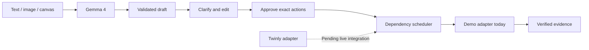
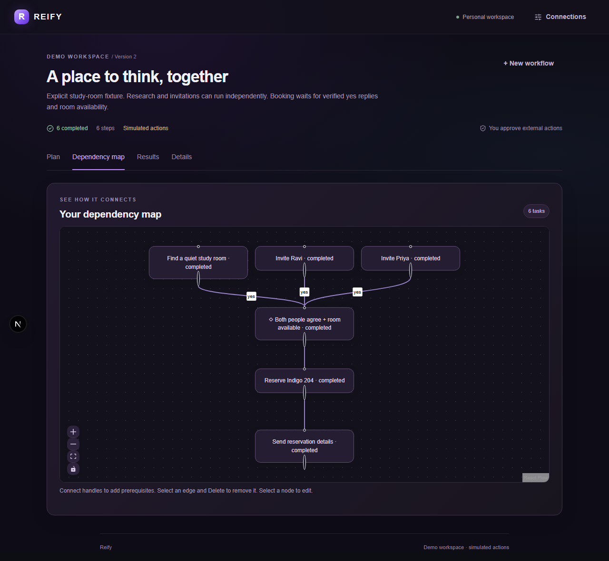

<div align="center">

# REIFY
### From thought to action.

Turn to-do lists, flowcharts and rough notes into structured workflows you can understand, edit and approve.

[Installation](docs/INSTALLATION.md) · [User guide](docs/USER_GUIDE.md) · [Mac handoff](docs/MAC_HANDOFF.md) · [Test evidence](docs/TEST_REPORT.md)

[](https://github.com/parvathinalla/reify/actions/workflows/quality.yml)


</div>

Reify is a general workflow product: capture an intention, surface missing information, review dependencies, approve exact actions, and inspect evidence. Study-room coordination is a controlled regression demo, not the product's entire purpose.

**Current release:** real Gemma 4 text parsing has succeeded locally. Input and workflow editing are implemented. Execution is a labeled local demo. The official Twinly adapter exists, but real Mac execution is not yet connected or verified. A key alone does not enable live actions.

## Start in three commands

Install **[Node.js 24 LTS](https://nodejs.org/)** and **[Git](https://git-scm.com/downloads)** first. Use PowerShell, Terminal, or VS Code:

```sh
git clone https://github.com/parvathinalla/reify.git
cd reify
npm run launch
```

Open **http://127.0.0.1:3000**. Keep the terminal open; press Ctrl+C to stop.

The launcher installs exact lockfile dependencies on first run, creates private .env.local if missing, and starts Next.js. Later launches reuse prepared dependencies until the lockfile changes. Existing keys are preserved. No global npm packages, Python, WSL or database are needed.

**Using the ZIP?** Extract it, open a terminal in the folder containing package.json, and run npm run launch.

### Connect Gemma in one edit

Open .env.local and add your own GEMINI_API_KEY from [Google AI Studio](https://aistudio.google.com/apikey). Keep GEMMA_MODEL set to gemma-4-26b-a4b-it. Save, stop the server, and run npm run launch again. Choose a format, enter text/upload an image, and click **Understand with Gemma 4**.

Put real keys only in .env.local, never .env.example, chat or GitHub. The private file is ignored by Git. Verify access with npm run check:gemma when ready; it makes real text/image requests and can consume quota. Without a key, the UI and deterministic fixture tests remain usable; interpretation of your source requires model access.

## Capability matrix

| Capability | Status |
|---|---|
| Typed lists and rough notes | Implemented; real Gemma text parsing verified locally |
| Images for all formats | Validation, safe preparation and multimodal SDK path implemented; real image inference still needs verification |
| Flowchart canvas | Nodes, arrows, branch labels and canonical parsing input |
| Clarification | Questions and answer-driven revisions; domain-specific completeness still needs stronger validation |
| Editable workflows | Task forms, dependency edges, complete-plan editing and DAG validation |
| Human approvals | Exact payload/version/digest; edits invalidate approvals |
| Deterministic execution | Local demo scheduler with prerequisites and yes/no/unknown conditions |
| Room verification example | Fictional inventory, simulated replies and persisted confirmation checks |
| Twinly | Official adapter and mocked HTTP tests; live mutations disabled |
| Desktop platforms | Cross-platform Node launcher; local Windows evidence; CI matrix for Linux/Windows/macOS |
| Public live execution | Not enabled; durable production storage and account authentication remain required |

See [the user guide](docs/USER_GUIDE.md) and [roadmap](docs/ROADMAP.md). Reify does not currently promise arbitrary autonomous actions across all apps.

## How it works



Gemma interprets; the server owns approvals, states and evidence. Understand does not execute actions. Missing/uncertain replies are not agreement. Credentials stay server-side.

## Useful commands

| Command | Purpose |
|---|---|
| npm run launch | Prepare if needed and start locally |
| npm run setup | Reinstall exact dependencies; preserve private settings |
| npm run doctor | Safe configuration booleans; no keys/provider calls |
| npm run check:gemma | Actual text/image connectivity; requires a key |
| npm run check | Lint, typecheck, unit tests and production build |
| npm run test:e2e | Fixture-based browser/API checks |
| npm run check:secrets | Scan publishable files and local Git history |

Install Chromium once before browser tests: npx playwright install chromium.

## Evidence and documentation

[TEST_REPORT](docs/TEST_REPORT.md) distinguishes local checks, mocked contracts and live evidence. No unverified provider result is claimed as passing.

<details>
<summary>See the verified workflow workspace</summary>



</details>

| Guide | Contents |
|---|---|
| [Installation](docs/INSTALLATION.md) | Quick install, keys, updates and build |
| [User guide](docs/USER_GUIDE.md) | Input, clarification, graph, approvals and verification |
| [Troubleshooting](docs/TROUBLESHOOTING.md) | Startup, quotas, keys, ports and Mac readiness |
| [Architecture](docs/ARCHITECTURE.md) | Schemas, state, trust boundaries and adapters |
| [Mac handoff](docs/MAC_HANDOFF.md) | Real Twinly setup and verification |
| [Roadmap](docs/ROADMAP.md) | Work remaining for broad live workflows |
| [Demo script](docs/DEMO_SCRIPT.md) | Honest three-minute demonstration |
| [Contributing](CONTRIBUTING.md) | Development and review conventions |
| [Security](SECURITY.md) | Credentials, local data and reporting |

## Hosting and license

Local .data files support one Node process. Vercel writes fail closed until durable storage and account ownership are implemented. This repository is not a hosted production service; no public application URL is claimed.

[MIT](LICENSE). Built with Next.js, React, TypeScript, Tailwind, React Flow, Zod, Lucide, Sharp, Google GenAI, Vitest and Playwright. Dependency licenses remain with their authors. See [third-party notices](THIRD_PARTY_NOTICES.md) for the sponsor OpenAPI reference and asset attribution.
