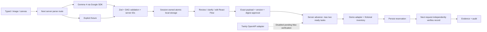

# Architecture

The server owns statuses, facts, approvals, execution IDs and evidence. Model output cannot complete tasks or grant approvals. Client plan edits are parsed through the draft schema, resetting status and invalidating approvals; they cannot inject evidence, facts or server ownership.

States: pending → needs clarification / blocked / awaiting approval → running → awaiting reply / verifying → completed. Dependency failure or denial skips downstream tasks. Explicit no/unknown conditions never count as yes. The demo scheduler has a two-task bound per atomic tick; this is cooperative scheduling within a request, not background parallel workers.

Storage operations are serialized within one process, written to a temporary file then renamed. Booking creation and workflow changes share the same persisted document. The next advance reloads the document before verification. Duplicate approvals cannot resurrect completed tasks; submitted IDs prevent duplicate actions. Execution locks material plan editing. Reconciliation/automatic retry is intentionally absent while live mutation routes remain disabled.

Image bytes never reach the workflow store. Source text and exact approved payloads remain local, so treat `.data` as sensitive. Session cookies are HTTP-only and same-site; mutation routes reject foreign origins. No account auth is supplied; do not expose local execution publicly.

The storage boundary is `lib/storage.ts` (`load`, `save`, `transact`, `writable`). A production adapter needs transactional row locking or compare-and-swap, durable audit/approval/submission records and account ownership checks. Vercel writes remain blocked until that adapter exists. Do not remove the guard just to deploy.

Gemma source: https://ai.google.dev/gemma/docs/core/gemma_on_gemini_api
Twinly source: https://github.com/OjasMishra32/twinly-api-examples/blob/main/openapi.yaml
The reference confirms /me, /messages, /tasks, /jobs/{id}, and cancellation. /computer/next-action is a separate controlled-screen API; it is not Mac delegation. Reify does not use guessed endpoints.
